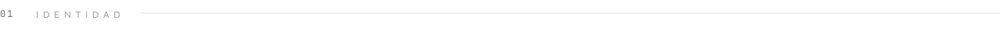
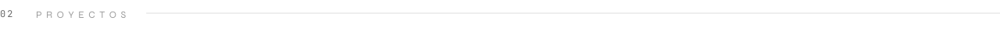
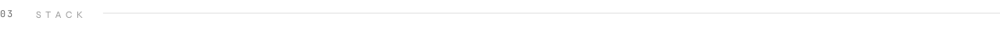
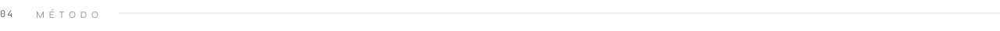
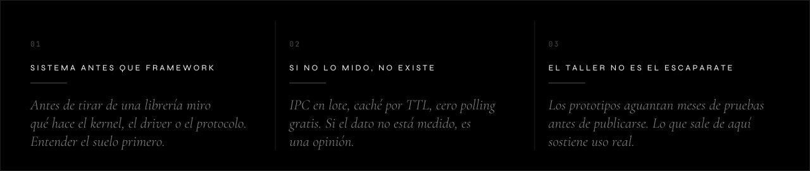
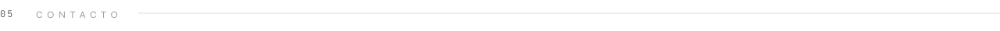

 

**DIVXAL** · Abel · A Coruña, ES

Construyo desde el sistema operativo hacia arriba. Linux a pelo, servicios que llevan meses
en un VPS sin caerse, interfaces de escritorio que hablan con el hardware, y visión artificial
cuando el problema no se resuelve con una API.

Estudiante de **1º de DAM** (*desenvolvemento de aplicacións multiplataforma*) y autodidacta
el resto del día. Nada de demos: lo que enseño aquí **está corriendo**.

 

 

<b>01 &nbsp;·&nbsp; ATLAS CENTER</b> &nbsp;—&nbsp; dashboard de sistema en tiempo real

 

| | |
|:--|:--|
| **Qué es** | Panel de escritorio que lee el hardware de verdad: CPU, GPU, RAM, NVMe, red, cámara IR. Un solo `IPC` en lote cada 500 ms con caché por TTL — sin avalancha de polling. |
| **Stack** | `Rust` · `Tauri 2` · `React 19` · `TypeScript` · `Three.js` · `OpenCV` |
| **Lo interesante** | Globo 3D con arcos a las IPs remotas activas, y reconocimiento facial con los modelos de `howdy` (dlib) sobre la cámara infrarroja. |
| **Estado** | Activo — código público |
| **Repo** | [`divxal/atlas-center`](https://github.com/divxal/atlas-center) |

<b>02 &nbsp;·&nbsp; ATLAS</b> &nbsp;—&nbsp; bot de Discord con memoria persistente

 

| | |
|:--|:--|
| **Qué es** | Bot con personalidad adaptativa por usuario, memoria entre conversaciones y capacidades multimodales. Vive 24/7 en un VPS con sus propios *crons* sin LLM para tareas de fondo. |
| **Stack** | `TypeScript` · `Node` · `LLM APIs` · `Docker` · `systemd` |
| **Lo interesante** | Cada persona que habla con él tiene su propio hilo de memoria; el bot distingue contexto personal, de clase y de comunidad. |
| **Estado** | En producción, en un servidor privado |

<b>03 &nbsp;·&nbsp; TYPOKAWAII</b> &nbsp;—&nbsp; juego de mecanografía en español

 

| | |
|:--|:--|
| **Qué es** | Juego de escribir rápido, en castellano y con estética propia. Corre como web app y mide precisión y WPM en vivo. |
| **Stack** | `React` · `TypeScript` · `Vite` · `Gemini API` |
| **Lo interesante** | Generación dinámica de frases y curva de dificultad en vez de un listado fijo de palabras. |
| **Estado** | Jugable — código público |
| **Repo** | [`divxal/TypoKawaii`](https://github.com/divxal/TypoKawaii) |

<b>04 &nbsp;·&nbsp; LABORATORIO</b> &nbsp;—&nbsp; lo que se está cociendo

 

| | |
|:--|:--|
| **VELION** | Distribución GNU/Linux institucional montada desde LFS, con entorno `labwc` + Quickshell. El sistema operativo como ejercicio de ingeniería, no como escritorio bonito. |
| **ORION** | Control de ratón y teclado sin contacto mediante seguimiento de gestos de mano en tiempo real (`MediaPipe`). |
| **EPSILON** | Motor de reconocimiento facial y seguimiento corporal orientado a entornos de producción. |
| **LEGION** | Control total de la iluminación RGB del portátil por ingeniería inversa del protocolo `USB HID` propietario. |

Prototipos y trabajo de taller: se publican cuando aguantan uso real, no antes.

 

**SISTEMAS** 

 

**LENGUAJES** 

 

**IA & VISIÓN** 

 

**HERRAMIENTAS** 

 

 

La mayor parte del trabajo vive en **repos privados** — aquí solo está lo que se puede enseñar.

 

### Hablemos.

Si tienes un proyecto, una idea, o simplemente quieres preguntar cómo está montado algo de aquí — escribe.

Respondo en menos de 24 h, de lunes a viernes.

 

fuera del código llevo <a href="https://divxal.com">divxal.com</a> — webs, visibilidad en buscadores y asistentes de IA, y auditorías para pymes

 

  

hecho a mano en <b>Syne</b> + <b>Cormorant Garamond</b> — los mismos tipos que el portfolio

